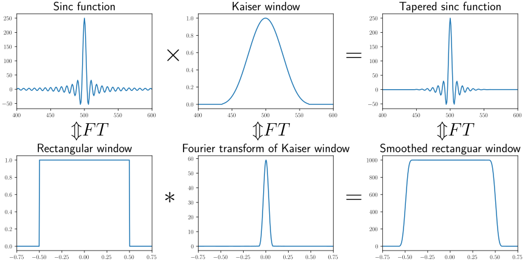
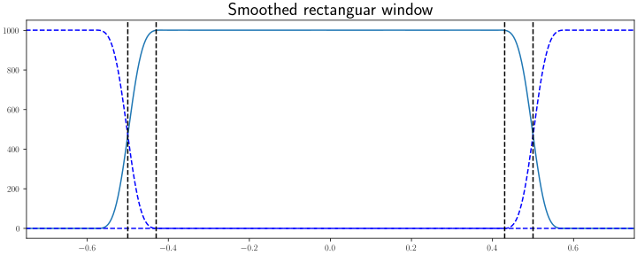
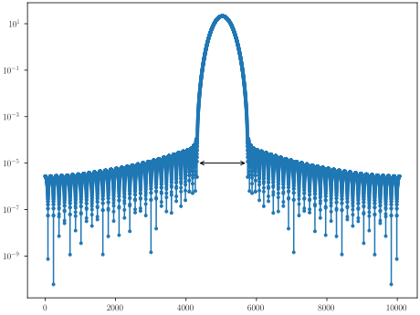
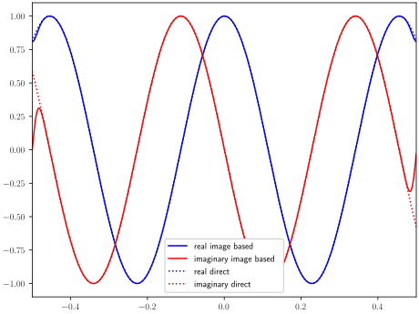
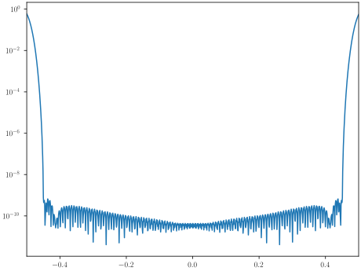

.. _sky-model-rendering-details:

Sky Model Resampling
====================

Introduction
------------
A sky model is a list of sources, their type (point, gaussian, ...), position (ra, dec), brightness and, if not a point source, other
parameters describing the shape.

The visibilities for these sources can be computed by evaluating the measurement equation.
Each predicted visibilities is the sum over the contributions of all the sources.
For large sky models, consisting of tens of thousands of components, the evaluation of the measurement equation is expensive.

An alternative method for computing visibilities is image based predict.
The input is an image instead of a list of sources. The computational cost depends on image size, but is independent from
the number of sources in the image. Depending on the number of sources this method can be faster than a direct predict based on a source list.

To use the image based predict method for a given a sky model, this list of sources needs to be converted into a model image.
The conversion method needs to be fast and accurate. Fast in the sense that the conversion time is small compared to the time
gained by using image base predict instead of direct predict.
Accurate in the sense that the difference between the  model visibilities from direct predict and image based needs to be small.

Below we describe both methods, identify causes of error and the parameters that affect the 
computational cost and the error. This leads to some guidelines to make a trade off 
between computational cost and error.

Direct Predict
--------------

The straightforward method to compute model visibilities is "direct predict".
This is a direct evaluation of the measurement equation for a list of components of given shape.

The shapes describing the sources are chosen such that there exists a closed form for the integral in the measurement equation.
This closed form is the coherence function.

Here we describe only the two most commonly used shapes: the point source and the Gaussian.

A point source is described by its position :math:`l_0, m_0` and brightness :math:`I_0`.
The brightness distribution is described by

.. math::
  I(l,m) = I_0 \delta(l-l_0, m-m_0)

where :math:`\delta` is the Dirac delta function.

The corresponding coherence function is

.. math::

   V(u,v,w) = I_0 e^{2\pi\jmath(ul_0 + vm_0 + wn_0))}

A Gaussian is also described by a position and brightness, but also by the parameters 
:math:`w_1`, the FWHM width along the major axis, and :math:`w_2` the FWHM width along the minor axis
and angle :math:`\theta`.
The angle is the angle of the major axis from north over east. 
It is assumed that these parameters are given in the image plane,
that is the plane tangent to the celestial sphere at the pointing direction.
If these parameters are given on the sphere and with respect to the local north,
they need to be converted to the image plane first.

The brightness distribution of a Gaussian is given by

.. math::
  I(l,m) = I_0 e^{-\|\mathbf{A}\mathbf{p}\|^2}

where

.. math::
  \mathbf{p} = \left[\begin{array}{c}
  l - l_0 \\
  m - m_0
  \end{array}\right]

is the position offset, and

.. math::
  \mathbf{A} = \left[\begin{array}{cc}
    1/\sigma_1 & \\
    & 1/\sigma_2
  \end{array}\right]
  \left[\begin{array}{cc}
    \cos\theta & -\sin\theta \\
    \sin\theta & \cos\theta
  \end{array}\right]

is a rotation and scaling matrix
The standard deviations :math:`\sigma_1` and :math:`\sigma_2` are derived from the
FWHM lengths :math:`w_1` and :math:`w_2` by

.. math::
  \sigma = \frac{w}{2\sqrt{2 \ln 2}}

The coherence function for a Gaussian is

.. math::
   V(u,v,w) = e^{2\pi\jmath(ul_0 + vm_0 + wn_0))} e^{-2\pi^2\|\mathbf{B}\mathbf{b}\|^2}

where

.. math::
  \mathbf{b} = \left[\begin{array}{c}
  u \\
  v
  \end{array}\right]

.. math::
  \mathbf{B} = \left[\begin{array}{cc}
    1/\sigma_1 & \\
    & 1/\sigma_2
  \end{array}\right]
  \left[\begin{array}{cc}
    \cos\theta & -\sin\theta \\
    \sin\theta & \cos\theta
  \end{array}\right]

Image Based Predict
-------------------

The alternative method for computing the visibilities is image based predict.
Here the sky model is first converted from a list of components to a model image.
The model image is fourier transformed to a uv grid. 
The visibilities are computed from the grid.
There is a computational cost per component for the resampling, a cost for the fourier transform of the model image,
and a cost per visibility to do the predict. But unlike the direct predict method there is no cost that is both per
source component and per visibility. 
For a sufficiently large number of source and components and visibilities, the image based predict method has
a lower computational cost than direct predict.

The whole procedure is outlined in the following graph

.. graphviz::

  digraph foo {
    rankdir="LR";

    invis1 [shape=point style=invis]
    invis2 [shape=point style=invis]

    node [shape=box];
    "invis1" -> "divide by\ntaper" [label="model\nimage"];
    "divide by\ntaper" -> "zero\npadding" [label="weighted\nmodel\nimage"];
    "zero\npadding" -> "Fourier\ntransform" [label="padded\n\weighted\nmodel\image"];
    "Fourier\ntransform" -> "convolution" [label="uv-grid"];
    "convolution" -> invis2 [label="visibilities"];
  }

The purpose of the skymodel resampler is to construct a model image such
that the visibilities match those produced by direct predict.

The choices to be made are:

* image size in pixels
* image resolution
* Number of pixels to update per component
* What resampling method to use

  * convolution  (point sources)
  * evaluation in uv domain :math:`V(u,v)`  (small Gaussians)
  * direct rendering :math:`I(l,m)` (large Gaussians)

Each choice affects computational cost and error.

Error Analysis
--------------

In essence, the difference between evaluating the measurement equation and
image based predict is the replacement of continuous integrals by sums over
a finite number of pixels. In the sampled version both the domain and the resolution
are limited. 

The figure below shows the uv-domain. The location of visibilities is indicated
by black dots. A predicted visibility is a weighted sum of the pixels around
the position of the visibility. For one visibility the the pixels that participate in the sum 
are indicated by a circle. The size of the circle is the support of the gridding kernel.
If the values of the pixels inside the bounding are accurate the predicted visibilities
will be accurate.
Because of the zero-padding in the procedure outlined above the pixels in the uv-grid are
interpolated by a circular convolution by a sinc function. 
Any discontinuity will cause ripples over the entire uv-grid.
Because of the circular convolution the edges wrap around. That means that there can not
be a discontinuity from edge to edge. The continuity is enforced by tapering.
The transition zone is not used for predicting visibilities. The values there are
inaccurate. Still the transition zone needs to be there to ensure that the 
edges join smoothly. 

.. image:: images/uv-coverage.svg

To sample the sources a tapered sinc function is used.
In the image domain this a sinc function multiplied by a Kaiser window.
In the uv-domain the sinc function is a rectangular function.
The Fourier transform of the Kaiser window looks similar to the original Kaiser windows,
except that a narrow window in the image domain is a wide window in the uv-domain.
And while in the image domain the support is just the main lobe, in the uv-domain
there are low level sidelobes.

Below the effective window is shown, now including the first alias to the left and right side.
The window extends beyond the center [-0.5, 0.5] region. Due to aliasing the tails of the window
will end up inside the center region, but for all significant aliasing this is within the transition zone.
The aliases cause a smooth transition from the edge to edge.

On a linear scale it looks like the reconstruction in the region of interest is perfect.
A plot of the Fourier transform of the Kaiser windows reveals that the side lobes are low, but not zero.

The predicted visibilities are show below. The visibility on the left edge (-0.5) is the conjugate of 
visibility on the right edge (0.5). The real part is symmetric. The smoothing by the aliases has barely
any effect. The imaginary part is anti-symmetric. The smoothing causes the imaginary part to go to zero towards the edges.

The prediction error is shown below on a logarithmic scale. In the transition zone the error is high,
but in the region of interest the error drops to low levels.

Choosing the rendering parameters
---------------------------------

The size of the model image in pixels is denoted by :math:`N`. The scale of the pixels is denoted
by :math:`s`. The extent of the image is then defined as :math:`d = Ns`.
The image extent is measured in the tangent plane. It is related to, but different from, the angular size,
which is the image size measured on the celestial sphere.

The imaging parameters :math:`N` and :math:`s` are derived from the positions of the components in the sky model,
the u,v,w coordinates in the measurement set

0. Choose a window based on the acceptable side lobe level. For a Kaiser window the 
side lobe level can be tuned with parameter :math:`\beta`. The Hann window has a fixed 
side love level. The side lobve level determines the error in the visibilities.

1. Choose a window size :math:`W`. In general a larger :math:`W` means more work
spend on resampling, and more room to make the trade off between quality (side lobe level) and 
work spend on image based predict (size of the transition zone).

2. Find the maximum l, m in the source catalog. The base extent of the image is given by :math:`d_0 = \operatorname{max}(l_{max}, m_{max})`

3. Find the maximum u,v,w in the MS. 
   The base scale of the image is given by :math:`s_0 = \frac{1}{2\operatorname{max}(u(\lambda), v(\lambda))}`

4. The image needs to be a bit larger than the base extent to account for the 
convolution by the tapered sinc: :math:`d = d_0 + W*s_0`

5. Choose window of size :math:`W`, making a trade off between side lobe level and width :math:`2f_0` in FT domain

6. The scale :math:`s` of the image needs to be a bit smaller than the base scale 
   :math:`s_0` to have room in the uv-domain for the transition zone and the w-kernel. :math:`s = s_0 / (1 + 2 f0 + 2 d w_{max}(\lambda))`
 
7. Finally, the size of the image in pixels is given by :math:`N = d/s`

The resolution of the model image needs to be somewhat larger than prescribed by the longest baseline to account for the 
gridding kernel and the transition zone. The image also needs to be a bit larger than the bounding box around the sources to
account for the width of the taper.

Choosing :math:`M` and :math:`\beta` for the Kaiser window
~~~~~~~~~~~~~~~~~~~~~~~~~~~~~~~~~~~~~~~~~~~~~~~~~~~~~~~~~~

The parameter :math:`\beta` determines the side lobe level. In image based predict the gridding kernel also causes an error.
Compared to predicting (degridding) the visibilities,  the cost of resampling the sources is small, so at relatively small
cost the error due to resampling can be made lower than the error in degridding. However, a resampling error lower than 
about 10dB below the gridding error has no additional benefit, because then the gridding error dominates.

The first null in the frequency response is given by (`ref <https://en.wikipedia.org/wiki/Kaiser_window>`__)

.. math::

  f_0 = \sqrt{1 + (\beta/\pi)^2}/W

The width of the main lobe of the frequency response of the Kaiser window is :math:`2f_0`.
This is also the extra room that is needed in the uv-domain for the transition zone.
The final minimum width of the model image required to accurate render the sources is

.. math::

  N = N_{bb} (1 + 2f_0)

Rendering Large Gaussian sources
--------------------------------

Gaussian sources that are sufficiently large can be rendered directly.
The pixels are assigned by evaluating the brightness distribution at the pixel positions

.. math::

  I[i,j] = I(i*dl, j*dm)

over a limited range of :math:`i,j`.

There are two sources of error in this method: the sampling causes aliasing and the Gaussian is cut off at some point.

To draw a Gaussian WSClean uses the DrawGaussian function from the external `schaapcommon library <https://git.astron.nl/RD/schaapcommon/>`_.
In this function the pixels included in direct rendering of Gaussians are the ones up to 
:math:`x = 20\sigma`. The value of the Gaussian at the edges is then

.. math::
  e^{\frac{-x^2}{2\sigma^2}} = e^{-200} \approx 1.4 \times 10^{-87}

The size of the smallest Gaussian that can be rendered directly depends on the acceptable level of aliasing.

For the renderer in wsclean the minimum size has been chosen to be 50 pixels.
The value of the coherence function at the edge of the uv-grid for a 50 pixel
wide Gaussian is 

.. math::

  e^{-2\pi^2\left(\frac{25}{2\sqrt{2\ln 2}}\right)^2} \approx 2.24 \times 10^{-39}

Both error are far below the side lobe level of the gridding kernel.

Sky component rendering in the uv-domain
----------------------------------------

The remaining sky components that are not point sources, but too small to be rendered directly,
are rendered in the uv-domain using the following procedure.

1. Select a sub-image of size :math:`W \times W` with its center pixel at 
   at offset :math:`i, j` with respect the the main image center pixel.

2. Evaluate the coherence function for the source shape on a grid of size :math:`W \times W`.

3. Multiply the grid with the phasor for the position offset of the source with respect to the sub-image center pixel
   The position offset is given by :math:`l_0 - i\, dl, m_0 - j\, dm`,

4. Multiply the grid with a taper with a flat top

5. FFT the grid from uv-domain to image-domain

6. Add the sub-image to the main image at the offset position

